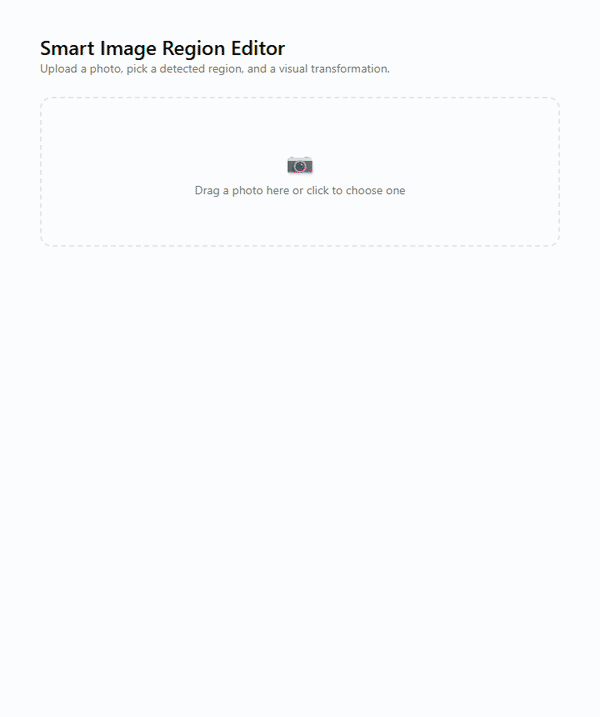
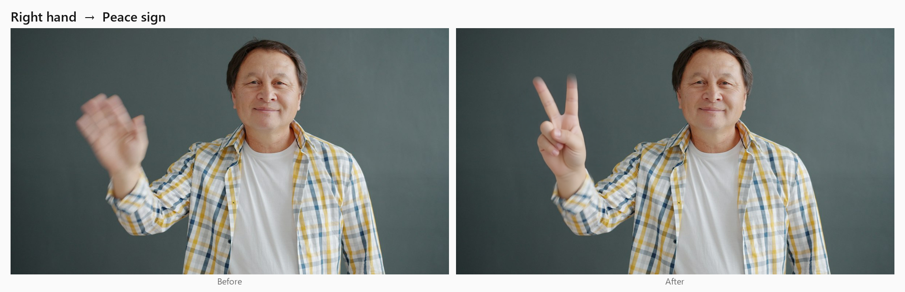
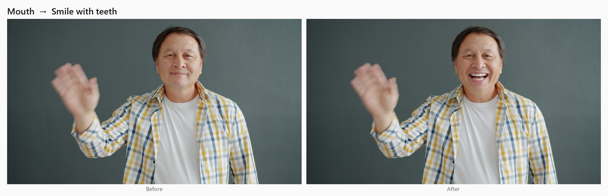
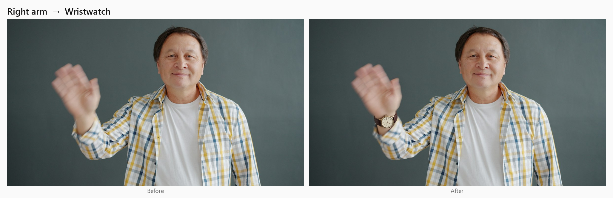
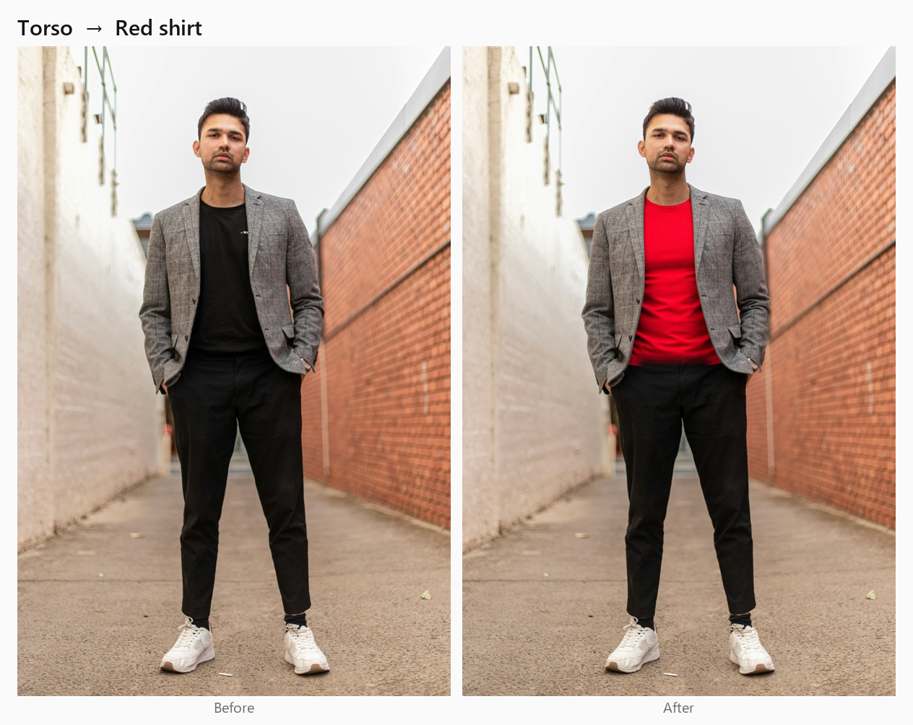
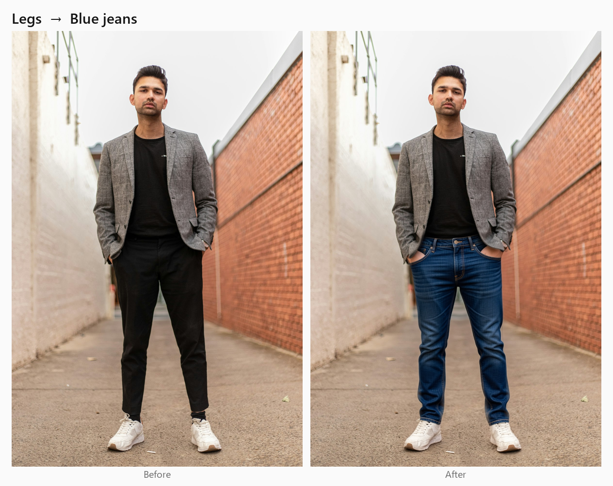

# Smart Image Region Editor

[](https://github.com/diego-caye/smart-image-region-editor/actions/workflows/ci.yml)

Upload a photo, and the app detects its regions: face, hands, mouth, eyes,
torso, arms, legs. Click one, pick a predefined edit like "✌️ Peace sign" or
"👖 Blue jeans", and only that region changes; everything outside it stays
pixel-identical. No prompts to type: every edit is a visual choice.

Hexagonal architecture (Ports & Adapters) in both backend and frontend.
ComfyUI ships in its own container, so cloning the repo and running
`docker compose up` is enough even without ComfyUI installed. See
[docs/architecture.md](docs/architecture.md) for the design decisions and
their reasoning.

## The app

Detected regions are drawn over the photo; clicking one opens the edits
available for it. While an edit runs, a progress bar says what it's
actually doing (masking the region, loading the model, each sampling step).
The result is compared in place with a before/after slider, and nothing is
applied until you accept it. Recorded on the real app (the wait for the
edit itself is sped up):



## Examples

Real outputs of the pipeline (SAM2 mask + Qwen Image Edit + compositing),
straight from the golden dataset run, not retouched.

**Hand gesture** — Right hand → Peace sign. The blurred mid-wave hand
becomes a crisp V; face, shirt and background are untouched.



**Expression** — Mouth → Smile with teeth.



**Accessory** — Right arm → Wristwatch, placed on the wrist of the raised
arm.



**Garments** — Torso → Red shirt changes only the T-shirt under the open
jacket; Legs → Blue jeans changes only the pants, keeping the hands in the
pockets and the sneakers.

 

<sub>Demo photos from Unsplash, used under the
[Unsplash License](https://unsplash.com/license): waving man by Vitaly
Gariev, full-body portrait by Mitchell Luo.</sub>

## What you can edit

| Region | Detected by | Edits |
|---|---|---|
| Left / right hand | YOLOv8 | 👋 Wave · ✌️ Peace sign · 👍 Thumbs up · ✊ Fist |
| Mouth | MediaPipe FaceLandmarker | 🙂 Smile · 😁 Smile with teeth · 😐 Closed mouth |
| Eyes | MediaPipe FaceLandmarker | 👀 Open eyes · 😌 Closed eyes |
| Torso | MediaPipe PoseLandmarker | 👔 Red shirt · 🧥 Black jacket · 👕 White T-shirt |
| Left / right arm | MediaPipe PoseLandmarker | ⌚ Wristwatch · 📿 Bracelet |
| Legs | MediaPipe PoseLandmarker | 👖 Blue jeans · 🩳 Shorts |
| Face, whole body | YOLOv8 / PoseLandmarker | detected and shown, not editable yet |

## How it works

1. **Detect** regions: YOLOv8 for face and hands, MediaPipe for mouth/eyes
   (on a crop around the face) and for torso, arms and legs (pose).
2. **Segment** the chosen region with SAM2, prompted with its box. For the
   torso it also segments the center of the chest and merges both masks, so
   an open jacket *and* the shirt under it are covered.
3. **Edit** a crop around the region with Qwen Image Edit (via ComfyUI),
   using an instruction written for that operation — the user never types
   it.
4. **Composite** the edit back through the mask, grown a little so a new
   shape isn't clipped (40px for gestures, 16px for garments). Outside that
   mask, every pixel is copied from the original: the model never gets the
   chance to change the rest of the photo.

## Current status

| Phase | What it includes | Status |
|---|---|---|
| 0 | Scaffolding, hexagonal structure, git | ✅ |
| 1–2 | Complete Domain + Application, image upload, persistence (SQLite) | ✅ |
| 3 | Face/hand detection (YOLOv8) + precise mask (SAM2), in the backend | ✅ |
| 3b | Frontend: selectable region overlay + visual operation gallery (shadcn/ui) | ✅ |
| 4 | Visual operation catalog | ✅ |
| 5 | Localized editing via ComfyUI + composition, end-to-end (backend + frontend) | ✅ |
| 6 | Golden dataset / evaluation | ✅ `region_preservation` + CLIP-based `edit_quality`, 5/5 bundled cases pass with real Qwen edits · `identity_preservation` is a documented stub |
| — | Docker deployment (backend + frontend, GPU) | ✅ |
| — | Extend to mouth/eyes/torso/arms/legs | ✅ expressions, garments (shirt, jacket, jeans, shorts) and accessories (watch, bracelet) are editable · face and whole-body are detection-only |
| — | Containerized ComfyUI (self-contained repo, no native install required) | ✅ shares the GPU politely by default; model download resumes if interrupted |

Everything marked "✅" has passing tests (unit + integration) and was also
verified against real running processes (`docker compose`, real detection
and real Qwen edits on real photos, and the UI driven in a browser).

**Ports**: `8420` (backend), `5180` (frontend), and `8188` (ComfyUI) by
default, rather than the usual `8000`/`5173` — all configurable in the root
`.env`.

## Requirements

- **Backend**: Python 3.12, in its own venv at `backend/.venv` (3.12 rather
  than newer for compatibility with torch/ultralytics/sam2/mediapipe).
- **Frontend**: Node.js 20+ and npm.
- **ComfyUI**: only needed for a **native** run (outside Docker) — a local
  install at `http://127.0.0.1:8188`, required for editing, not for
  detection/upload. **Not needed in Docker**: `docker compose up` spins up
  its own ComfyUI container (see the Docker section below).
- **GPU**: an NVIDIA GPU. Developed on an RTX 5080 (Blackwell), which needs
  the `cu130` PyTorch build (`torch==2.10.0+cu130`, the same one ComfyUI
  uses) — PyPI's default index would install a build without support for
  that GPU.
- **Docker** (optional, for deployment): Docker with the NVIDIA container
  runtime (check with `docker run --gpus all ... nvidia-smi`).

## Backend (native)

```powershell
cd backend
py -3.12 -m venv .venv          # first time only
copy .env.example .env          # adjust if needed

./.venv/Scripts/pip install -e ".[dev]"
# Detection/segmentation (Phase 3) — PyTorch build pinned for the RTX 5080:
./.venv/Scripts/pip install "torch==2.10.0+cu130" "torchvision==0.25.0+cu130" --index-url https://download.pytorch.org/whl/cu130
./.venv/Scripts/pip install -e ".[ml]"

./.venv/Scripts/uvicorn app.main:app --reload --port 8420
```

- API at `http://127.0.0.1:8420`, interactive docs at `/docs`.
- SQLite database at `backend/data/app.db` (created automatically). Images in
  `backend/data/images/{original,mask,preview,final}/`. SAM2 checkpoint
  cached in `backend/models_cache/` (downloaded only the first time,
  ~300MB, from Hugging Face — ComfyUI's `.safetensors` doesn't work here
  because its node loads it with a different loader than the official
  `sam2` package).
- Tests: `./.venv/Scripts/pytest` — fast, don't require GPU/models/ComfyUI by
  default. To also run the ones that do:
  `./.venv/Scripts/pytest -m live_models` (real YOLO+SAM2) or
  `./.venv/Scripts/pytest -m live_comfyui` (real Qwen Image Edit).

Endpoints available today:

- `POST /images` — uploads an image (multipart `file`), returns
  `{image_id, width, height, url}`.
- `POST /images/{id}/analyze` — runs real detection (YOLOv8 face+hands +
  MediaPipe mouth/eyes/body/torso/limbs) and persists the found regions.
- `GET /images/{id}/regions` — re-reads the already-detected regions.
- `GET /regions/{region_type}/operations` — catalog of operations valid for a
  region type (e.g. `right_hand` → wave/peace/thumbs-up/fist, `legs` →
  blue jeans/shorts).
- `POST /images/{id}/edits` — `{region_id, operation}` → real localized
  editing (SAM2 + Qwen Image Edit via ComfyUI + composition), returns a
  preview without touching the "official" image yet. Takes ~95s in Docker
  with the default GPU-sharing settings, measured: ~20s masking with SAM2,
  ~10s reading the instruction, ~40s loading the Qwen model, then a few
  seconds per sampling step. Much faster with the models kept loaded.
  Optionally send a `progress_id` (any `[A-Za-z0-9_-]{1,64}` token you
  choose) to follow the edit while this request is still running.
- `GET /edits/progress/{progress_id}` — the running edit's current stage
  (`segmenting`, `reading_instruction`, `loading_model`, `generating` with
  step/steps, `decoding`, `compositing`, `done`) and a 0-1 fraction. 404
  until the edit reports its first stage.
- `POST /edits/{id}/confirm` — the preview becomes the session's current
  image; the next edit is applied on top of this result, not the original.
- `POST /edits/{id}/discard` — discards the preview, the session doesn't
  change.
- `GET /static/{storage_ref}` — serves the bytes of a saved image.

### Golden dataset / evaluation

`backend/tests/evaluation/`:

- `evaluators/region_preservation.py` — measures in pixels whether
  everything outside the mask stayed the same between the original and the
  final image.
- `evaluators/edit_quality.py` — checks the requested edit actually
  happened: zero-shot CLIP (`openai/clip-vit-base-patch32`, on CPU) must
  classify the edited region as the requested operation, and more
  confidently than the original.
- `evaluators/identity_preservation.py` — documented stub, not implemented
  yet.
- `datasets/golden_*_edits.json` — one case per kind of edit (gesture,
  expression, shirt, jeans, wristwatch) on Unsplash-licensed photos, which
  are downloaded on first run and never committed. Run them with:

  ```powershell
  ./.venv/Scripts/pip install -e ".[eval]"
  ./.venv/Scripts/pytest -m live_comfyui tests/evaluation/test_golden_dataset.py
  ```

  Set `GOLDEN_OUTPUT_DIR` to also save every final image — the scores don't
  catch everything (see below). See `datasets/README.md` to add your own
  photos.

Latest results, all 5 passing. The score is the probability CLIP gives the
requested operation, among the ones allowed on that region, before → after:

| Case | edit_quality (CLIP) |
|---|---|
| Right hand → Peace sign | 0.19 → 0.93 |
| Mouth → Smile with teeth | 0.30 → 0.74 |
| Right arm → Wristwatch | 0.64 → 0.90 |
| Torso → Red shirt | 0.03 → 0.98 |
| Legs → Blue jeans | 0.38 → 0.98 |

The first real run is what found three bugs: the preservation check was
measuring against the raw mask instead of the one the compositor actually
blends with; on a person in an open jacket, SAM2 masked only the jacket,
leaving a black stripe down the red shirt; and the first red-shirt prompt
painted the jacket's sleeves. CLIP still scored the striped shirt 0.85 —
only looking at the images caught it, which is why `GOLDEN_OUTPUT_DIR`
exists.

## Frontend (native)

```powershell
cd frontend
npm install
npm run dev      # http://localhost:5180
npm test         # vitest
npm run build    # type-check + production build
```

Points at `http://127.0.0.1:8420` (backend) by default. To change it, copy
`.env.example` to `.env.local` and adjust `VITE_API_BASE_URL`.

UI built with [shadcn/ui](https://ui.shadcn.com) (Radix + Tailwind v4) —
components generated in `src/presentation/components/ui/` via
`npx shadcn@latest add <component>` (the root `components.json` already
points the `@/presentation/...` aliases at the project's hexagonal
structure, not shadcn's default paths).

The full flow works end-to-end: upload an image → **Analyze image** (real
YOLOv8 + MediaPipe detection, up to 10 region types: face, hands, mouth,
eyes, body, torso, arms, legs) → overlay of selectable, colored boxes over
the image, larger regions rendered first so smaller ones nested inside them
(e.g. a hand inside an arm) stay clickable → click a region → visual
operation gallery (emoji + label, never plain text) → select one →
**Generate preview** (real SAM2 + Qwen Image Edit via ComfyUI, with a
progress bar showing the current stage and elapsed time) → before/after
slider over the same photo →
**Accept** (the session's image advances; a second edit is applied on top of
this result, not the original — right hand→peace and left hand→thumbs-up
coexist in the same photo) or **Discard** (no changes).

## Docker

```powershell
copy .env.example .env
docker compose up --build
```

This spins up **three** containers — frontend, backend, and **ComfyUI
itself** (vanilla clone, no custom nodes — see
[docs/architecture.md](docs/architecture.md)). You don't need ComfyUI
installed on the host for this to work: that's precisely the point of
containerizing it, so cloning this repo and running one command is enough.

- Frontend at `http://localhost:5180`, backend at `http://localhost:8420`,
  **ComfyUI's own UI at `http://localhost:8188`** (useful for inspecting the
  graph/queue directly).
- First start: the `comfyui` container downloads ~31GB of models (Qwen Image
  Edit + LoRA + text encoder + VAE) into a named volume (`comfyui_data`) —
  takes a while depending on your bandwidth, but only the first time;
  subsequent starts are instant. If the container restarts mid-download, it
  resumes where it left off.
- ComfyUI assumes it shares the GPU with other software by default: it
  offloads its models after each edit and keeps 4GB of VRAM free
  (`COMFYUI_EXTRA_ARGS` in `docker-compose.yml`). That makes each edit
  slower since the models reload every time; if nothing else uses your GPU,
  set `COMFYUI_EXTRA_ARGS=` (empty) in `.env` to keep them loaded.
- The backend runs with GPU access (`deploy.resources.reservations` in
  `docker-compose.yml`) for SAM2; ComfyUI also requests it for Qwen Image
  Edit. If your machine doesn't have Docker's `nvidia` runtime configured,
  remove those `deploy` blocks from both services and set
  `SEGMENTATION_DEVICE=cpu` in `.env` (editing via ComfyUI will be much
  slower without a GPU).
- `COMFYUI_BASE_URL` inside the backend container points by default at
  `http://comfyui:8188` (the service's name on Compose's internal network).
  If you'd rather keep using a native ComfyUI install (e.g. with your own
  custom nodes), uncomment the `COMFYUI_BASE_URL=
  http://host.docker.internal:8188` line in `.env` — in that case the
  `comfyui` container still starts up, but the backend simply doesn't use
  it.
- YOLO weights are optionally reused by mounting `COMFYUI_MODELS_DIR` (from a
  native install, if you have one) as a read-only volume; if it's not
  configured or the file isn't there, the backend downloads them itself from
  Hugging Face — never a hard requirement.
- Data (SQLite + images), the SAM2/MediaPipe cache, and ComfyUI's models
  persist in named volumes (`backend_data`, `models_cache`, `comfyui_data`) —
  they survive `docker compose down` (not `docker compose down -v`).

## Structure

See the full tree and the reasoning behind each folder in
[docs/architecture.md](docs/architecture.md). Summary:

```
backend/app/{domain,application,adapters,infrastructure}/
frontend/src/{domain,application,adapters,infrastructure,presentation}/
```

Domain and Application don't import FastAPI, SQLAlchemy, PyTorch, ComfyUI,
React, or `fetch` — only Adapters/Infrastructure (backend) and
Adapters/Infrastructure (frontend) do.
